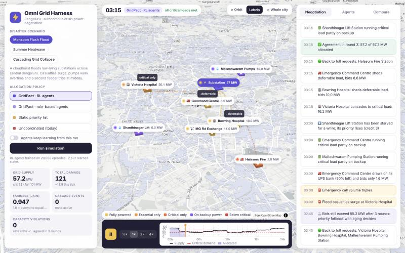

# Omni Grid Harness

**Autonomous multi-agent negotiation for crisis power allocation, simulated live on a 3D map of Bengaluru.**

During a disaster, hospitals, water pumping, emergency services and telecom all draw on a shrinking,
fluctuating power supply, and today they do it in isolation. Omni Grid Harness gives each utility its
own agent. Every 15 simulated minutes the agents negotiate over the available megawatts through bids,
priorities and concessions, under a protocol that guarantees hard capacity limits, consistent state,
no deadlock, and fairness, while minimising total damage across a 24-hour disaster.



## Results (24-hour scenarios)

| Policy | Monsoon flood | Heatwave | Grid collapse | Capacity violations |
| --- | ---: | ---: | ---: | ---: |
| **GridPact · RL agents** | **2,258** | **983** | **2,702** | 0 |
| GridPact · rule-based agents | 2,515 | 1,226 | 3,341 | 0 |
| Static priority list | 13,393 | 7,076 | 17,826 | 0 |
| Uncoordinated (today) | 6,204 | 3,705 | 7,904 | 0 |

Damage is in harm points (lower is better); the **Compare** tab and `/api/compare` show the live numbers.
GridPact cuts damage by 64–73% against the better of the two non-negotiating baselines. Across the three demo scenarios the trained RL agents cause **16% less damage** than the
hand-written rule-based agents. On **200 unseen randomised disasters** they average **10% less damage**
and do better in 134 of 200 runs, so the gain generalises beyond the scenarios used for model selection.

Reproduce the named-scenario scores and random-disaster comparison with the checked-in model:

```bash
python3 -m omnigrid.benchmark --seed 42 --random-cases 200 --output models/benchmark_seed42.json
```

The benchmark evaluates each named scenario once under all four policies, then generates 200 random
scenarios from seed 42 and compares RL with the rule-based policy on each same scenario. Both policies
use the same per-case simulation seed; the report includes the model episode count and state count.
The random results report mean damage, RL wins, and mean damage reduction. Use the JSON report to
confirm the figures above for the current `models/qtable.json`; retraining can change those figures.

## How it works

```
Scenario (supply curve + surges + refuels)
        │
        ▼
Utility state ──► Need (critical / essential / deferrable MW, backup available)
        │             computed by the simulator, so agents cannot inflate it
        ▼
Agents bid  ──►  up to 3 negotiation rounds (bids may only go down)
        │
        ├─ bids fit supply? ──► grant, then top up leftover by priority
        └─ still over?      ──► deterministic fallback: critical floors first,
                                 remainder weighted by priority + starvation aging
        ▼
Safety layer (Banker's-style safe-state check for life-critical loads)
        ▼
Ledger: atomic, invariant-checked commit as one-tick leases
        ▼
Apply power ──► backups drain/recharge ──► damage + cascades ──► rewards (RL)
```

### The agents (7)

| Agent | Area | Backup | Life-critical |
| --- | --- | --- | --- |
| 🏥 Victoria Hospital | K.R. Market | diesel generator | yes |
| 🏥 Bowring Hospital | Shivajinagar | diesel generator | yes |
| 💧 Malleshwaram Pumping Station | Malleshwaram | reservoir tank | |
| 💧 Shanthinagar Lift Station | Shanthinagar | sump capacity | |
| 🚒 Emergency Command Centre | Ambedkar Veedhi | UPS bank | |
| 🚒 Halasuru Fire Station | Halasuru | none | |
| 📡 MG Road Telecom Exchange | MG Road | battery bank | |

Facilities are simulated and placed in real Bengaluru neighbourhoods. They do not model real plant data.

Each agent picks one of four bids per round: **full load**, **essential only**, **critical only**, or
**draw on backup** (bid below critical and cover the gap from its tank, battery or generator).

### Guarantees and how they are enforced

| Requirement | Mechanism |
| --- | --- |
| Hard capacity limits | Ledger rejects any allocation whose total exceeds supply. Every policy's run is checked in tests. |
| No inconsistent states | All-or-nothing commit of the whole tick; every utility appears exactly once; no double commits |
| No deadlock | No hold-and-wait (power exists only after commit), one-tick leases (preemption), a global priority order (no circular wait), bounded rounds with a guaranteed fallback |
| No livelock | Bids are monotonic within a tick, and there are at most 3 rounds |
| Priority vs fairness | Starvation credit raises an agent's effective priority while it is held below normal operation (aging) |
| Life safety | Safe-state check: a hospital may not be short of critical load while power sits above anyone else's critical floor |
| Cascades | Dependencies (telecom → dispatch, water → hospitals and fire) cut a dependent's effectiveness when the upstream utility is down |

### Learning

Each utility has its own tabular Q-learning agent over a small local observation (round, supply ratio,
shortfall, backup level, starvation credit, crisis flag, upstream outage), so the system stays
decentralised. The reward is 70% shared (city-wide damage) and 30% individual, which teaches
cooperation instead of greedy bidding. Unvisited states fall back to the rule-based policy, so the RL
agents never start below the heuristic. Agents can keep learning from live runs in the dashboard.

## Run it

Requires Python 3.10+ and no third-party packages. The map loads MapLibre and OpenFreeMap tiles
from the internet; if tiles are unreachable, the simulation still runs on a blank basemap.

```bash
python3 -m omnigrid.server
```

Open http://localhost:8000.

Retrain the agents (about 3.5 minutes for 20,000 episodes):

```bash
python3 -m omnigrid.train --episodes 20000 --eval-every 500 --fresh
```

Run the tests:

```bash
python3 -m unittest discover -s tests -t .
```

## API

| Endpoint | Returns |
| --- | --- |
| `GET /api/meta` | utilities, substation, scenarios, policies, model info |
| `GET /api/run?scenario=&policy=&learn=0\|1` | full 96-tick episode plus summary |
| `GET /api/compare?scenario=` | all four policies side by side |
| `GET /api/learning` | RL learning curve |

Scenarios: `monsoon_flood`, `heatwave`, `grid_collapse`.
Policies: `gridpact_rl`, `gridpact_heuristic`, `static_priority`, `uncoordinated`.

## Project layout

```
omnigrid/
  config.py       time constants, the 7 utilities, dependencies
  utility.py      per-utility state, load tiers, backup buffers
  scenario.py     disaster scenarios and the random training generator
  damage.py       damage and cascade model
  ledger.py       atomic commits, invariants, leases
  protocol.py     negotiation rounds, fallback allocator, safety layer
  baselines.py    uncoordinated and static-priority allocators
  agents/         rule-based and Q-learning agents
  narrator.py     plain-English negotiation log
  simulation.py   episode loop and metrics
  train.py        training CLI and learning curve
  server.py       HTTP API and static file server
web/              3D map dashboard (MapLibre GL, vanilla JS)
models/           trained Q-tables and learning curve
tests/            protocol, ledger and end-to-end tests
```
